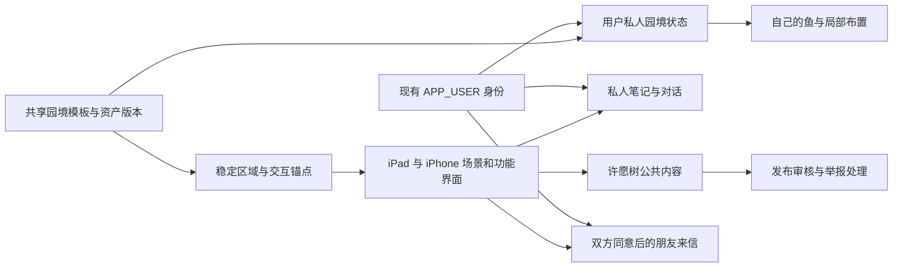
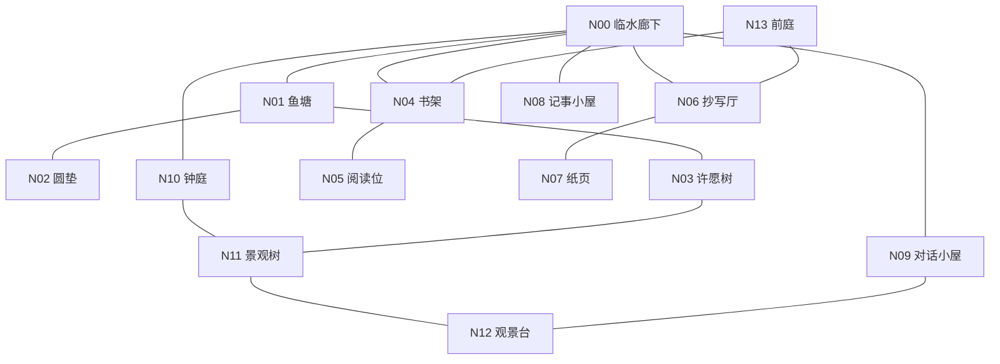

# Invelle iPad / iPhone 轻生活游戏 v1：产品、模型与第一视角设计

> 2026-10-22 导航修订：首次进入全园俯视图，再进入所选空间全景，最后显式进入第一视角。返回逐级退出。以下旧路径中的 N00 起点应在此三级导航之后理解；导航状态须同时保留 nodeId 与 level。以[导航层级修订](Invelle轻生活游戏-v1-导航层级修订-20261022.md)为准。

日期：2026-10-21。阶段：开发设计，未实现、未部署、未安装设备。本稿用于产品评审、建模补件和前后台开发拆分。已按本轮补充要求纳入 iPhone 适配及 Apple／邮箱账号；文件名沿用首稿，避免既有引用失效。

**定位：以生活感和持续的人际来往为核心，带解压性质的轻游戏。许愿树承担主要社交连接；养鱼与布置提供日常乐趣；聊天、阅读、抄写与记事承接个人表达。**

配套材料：[前后台开发设计](iPad轻生活游戏-v1-前后台开发设计-20261021.md) · [Skill 评审](iPad游戏设计-Skill检索与评审-20261021.md) · [核对证据](ipad-v1-evidence/asset-and-source-inventory.json) · [空间绑定草案](ipad-v1-evidence/spatial-bindings-v1.json)。空间绑定是设计数据，不是可直接装入产品的运行配置。

实施要求已拆入[需求说明书](Invelle轻生活游戏-v1-需求说明书-20261021.md)、[第一视角操作规范](Invelle轻生活游戏-v1-第一视角操作规范-20261021.md)、[数据与接口对应](Invelle轻生活游戏-v1-数据与接口对应-20261021.md)及[本地存储与同步机制](Invelle轻生活游戏-v1-本地存储与同步机制-20261021.md)；本文继续维护产品范围、空间与路径，不复制技术契约。

## 1. 本版决定与适用边界

### 1.1 当前会话已经确认

| 项目 | 已确认方向 |
| --- | --- |
| 产品内核 | 类似动森的轻生活游戏，带解压性质；借鉴生活与交往机制，不复制角色、美术或内容 |
| 私人世界 | 每个用户的小世界及数据独立隔离；共用模型资源，不共用私人存档 |
| 社交中心 | 通过许愿树交流，只共享主动提交的内容；支持回应与持续来往 |
| 养鱼 | 养几条自己的鱼，互动和布置；不以繁育、稀有度和经营为首版中心 |
| 移动 | 第一视角点击地点前往，到达后坐下、环顾；不以自由操纵角色行走为默认 |
| 语音 | 支持语音表达；本版设计包括原声愿签、回应、朋友来信与私人记录 |
| 既有功能 | 聊天对应对话小屋；社区对应许愿树；阅读对应读经厅；呼吸对应池塘圆垫；记事本放在小屋 |
| 设备 | 同一 App 最终支持 iPad 与 iPhone；本轮优先 iPad 横屏视觉与开发，电脑浏览器及 iPad 模拟器调试，iPhone 随后适配，共用玩法和数据 |
| 登录 | 纳入 Apple 账号和邮箱登录，复用现有此间账号体系 |
| 天气与参考机制 | 纳入已有模型天气／时段表现；吸收个人空间、有限浏览和低压力交流机制，保留朋友持续来往 |
| 后台 | 复用 Zenflow 的账号、聊天、社区、阅读、私人记录和运营能力 |
| 当前授权 | 整理第一版设计与 Skill 候选；不由此开始业务实现、迁移、发布或安装 |

### 1.2 为使方案可实施采用的设计默认值

以下具体默认值仍需通过小样验证，不写成已经完成用户验收的业务规则：稳定昵称；互相同意后成为朋友；原独处侧室增加持久记事本；首版只做站内信盒提示；语音单条暂按 60 秒、上限 5 MiB 设计；养鱼初始 3 条、最多 5 条为可配置候选；天气首版手动选择，初次进入用白天，随后恢复本人上次明确保存的选择。

暂不纳入首版：实时多人同园、实时语音通话、陌生人私信、鱼类繁育、交易与货币、付费礼物、排行、连续签到、整园自由建造、年度情绪报告、AI 自动代写或代回社区消息、系统推送。朋友互访暂以主动分享的照片或明信片表达，三维庭院快照互访作为后续扩展。

首版包括基础手写保存，复杂书法模拟、手写识别、跨语言语音翻译、AI 回答朗读暂不作为完成条件。上架年龄范围、最低支持 iPad／iPhone 和审核运营安排列为实施前须明确的事项，不阻碍本次设计交付。

### 1.3 与旧空间总纲的修订关系

[空间总纲 v1.2](禅意空间-设计总纲-v1.2-Blender制作版-20261020.md)仍负责建筑、材质和 Z01–Z12 布局；本稿更新 iPad／iPhone 产品功能和交互，不追溯宣称旧模型已支持业务。

| 旧条款 | 本版调整 |
| --- | --- |
| 许愿树主要是公开留言，未纳入评论、朋友 | 加入文字／原声回应、愿签后续、互加朋友和朋友来信；需新增业务与治理能力 |
| 水中坐垫只有自由静坐，无呼吸协议 | 保留自由静坐，增加主动开启的呼吸节律与手势互动；不测量真实呼吸 |
| Z06 侧室只有临时纸 | 另放一本持久记事本；临时纸与持久记录的入口、存储和删除行为分离 |
| 不发任何回访提示 | 可在站内呈现真实回应与来信；不设置虚构等待或缺席惩罚，首版不启用推送 |
| 场景动作不产生长期结果 | 鱼的名字、选用鱼型、布置和个人作品可以保存；不从使用量计算人格、疗愈或社交价值 |

## 2. 模型地址、版本与使用方法

模型项目与应用工程分别保留：

- 应用根目录：`/Users/mark.ma/Documents/AI coding/zenflow`。
- 模型根目录：`/Users/mark.ma/Documents/AI coding/zenflow-space`。
- 建模讨论：[Blender 禅意空间建模与四期交付](codex://threads/01a158b4-993e-7d11-b539-124652811514)。

| 资产 | 本轮核实地址 | 用途和状态 |
| --- | --- | --- |
| 可编辑主文件 | [zen-space.blend](../../../zenflow-space/docs/design/blender/zen-space/zen-space.blend) | 会随建模任务更新；首稿核对时与 p3-v039 快照一致，天气核查时已到 p3-v042 |
| 本设计固定源版本 | [p3-v039 日期快照](../../../zenflow-space/docs/design/blender/zen-space/snapshots/20261021/zen-space-p3-v039.blend) | 本稿相机、节点和区域绑定的依据 |
| 全园导出 | [zen-space-p3-v039.glb](../../../zenflow-space/docs/design/blender/zen-space/exports/zen-space-p3-v039.glb) | 152,322,124 字节，约 145.27 MiB；不能直接当作合格 iPad 资源包 |
| 实际渲染图册 | [final-review.html](../../../zenflow-space/docs/design/blender/zen-space/previews/final-review.html) | 本地静态图册，可直接打开；不是业务界面 |
| 交互模型预览 | [full-model.html](../../../zenflow-space/docs/design/blender/zen-space/previews/runtime/full-model.html) | 需要模型项目 HTTP 服务，不是 iPad 应用 |
| 当前资产声明 | [current-work-manifest.json](../../../zenflow-space/docs/design/blender/zen-space/evidence/current-work-manifest.json) | 首稿读取为 p3-v039；天气核查时已到 p3-v042，视觉 PARTIAL，设备未验证；本稿绑定仍固定 p3-v039 |
| 场景与路线 | [scene-manifest.json](../../../zenflow-space/docs/design/blender/zen-space/manifest/scene-manifest.json) | 12 个区域、33 个相机和路线分段；不是已实现导航系统 |
| 还原度审查 | [v039 修复记录](../../../zenflow-space/docs/design/blender/zen-space/evidence/fidelity-repair-review-v039.md) | 已知景观、屋顶、远山及部分坐姿构图仍有差距 |

历史预览 URL 为 `http://127.0.0.1:18764/docs/design/blender/zen-space/previews/runtime/full-model.html`。本轮读取超时／连接中断，因此只确认文件存在，不宣称这个服务当前可用；不为本次文档任务重启其他任务的服务。

本轮开始时已交付版为 p3-v035；整理期间建模任务交付 p3-v039，已重新核对主文件、日期快照、GLB 和全部引用节点，并将本稿固定到 p3-v039。中间制作文件不作为独立发布依据。`release-manifest.json` 仍记录 p1-v011，是第一期历史清单，不应误读为最新版本。

固定快照 SHA-256：`98ad08fb268fd71bb76598cce45e17c1f145819d145e3172ac950481c671ec24`。GLB SHA-256：`ac5519c038d8d5f72a34e72a1062514f6be64842ebad33b387f240cdbf73bfa7`。

GLB 本轮只读解析得到 7,752 个节点、1,195 个网格定义、74 个纹理记录、33 个相机和 17 段生灵动画。以上是文件结构证据，不能代替运行帧率、纹理显存、触摸或视觉验收。

## 3. 模型、用户与功能的关系

同一套建筑模型供所有用户使用；每个人保存小型状态数据，如鱼的名字、鱼型、摆件位置、设置和上次停留点，不复制整个 Blender／GLB 文件。园境状态归属于当前账号，公开愿签也不会直接写进模型资产。

三维节点只表达「这里有一个书架／木签／坐垫」。功能由稳定业务锚点连接：例如 `wish.take` 映射到 `ANCHOR_Z08_TAG_TAKE`，再由原生界面打开愿签编辑器。用户名、私人正文、令牌和音频文件不烘焙进 GLB。

同一棵公共树不等于同一个多人房间。树上的可见木签按当前用户能访问的内容投影，双方不必在线。树枝上的槽位不是帖子永久地址；愿签自身有稳定内容 ID，刷新、换模型和撤回都不改变授权规则。

AI 模型是另一类对象：沿用服务端已发布的陪伴配置和模型路由。三维资产版本与 AI 配置版本分别管理，不能用切换场景模型的动作更改 AI 供应商或用户授权。

## 4. 区域、功能与数据归属

| 区域 | 本版功能与可操作对象 | 数据归属／复用 | 模型补件 |
| --- | --- | --- | --- |
| Z01 庭院与临水廊 | 落脚、环顾、前往各处；看猫、轻触互动 | 相机位置本地；偏好归本人；动物环境动画共用 | 中央分路导航锚点、猫的产品交互碰撞体 |
| Z02 水园与双桥 | 喂鱼、拨水、命名、选鱼、限定区域布置、拍照 | 新增本人鱼塘状态；即时涟漪不逐帧上传 | 临岸喂食热点、可摆放面、鱼型映射和近看视点 |
| Z03 低岛圆垫 | 坐下、静坐、主动开启呼吸节律、停止 | 设置归本人；不记录呼吸表现 | 可点击坐垫碰撞体、节律表现层 |
| Z04 读经厅 | 取书、阅读、书签、摘句、私人批注 | 复用书籍与阅读状态，笔记关联新增 | 现有 4 个选书节点保留，补动态书目映射 |
| Z05 抄经厅 | 选句、自由书写、撤销、保存、主动投稿 | 私人作品归本人；投稿另生成审核快照 | 复用纸笔锚点；字帖和纸面状态由应用提供 |
| Z06 独处侧室 | 持久记事本、原声记录、收藏；另有不保存的临时纸 | 复用私人记录，补原声／笔迹附件 | 新增持久记事本、收藏册锚点；不可复用临时纸 ID |
| Z07 钟庭 | 敲钟、放石等短互动 | 默认不持久化，不分析情绪 | 复用钟与石头锚点，动作需运行时接入 |
| Z08 许愿树 | 发愿签、听原声、回应、更新后续、认识朋友、查看来信 | 复用社区，新增回应、关系、信盒和原声媒体 | 取签及 6 个木签槽已在导出；补信盒与朋友入口 |
| Z09 景观大树 | 途经、看树、自然停留 | 无业务记录要求 | 保留景观，不再复制许愿功能 |
| Z10 观景台 | 看晨昏、拍园景、制作明信片 | 照片先归本人，发布或寄送另行确认 | 复用东／西观景相机，补拍照操作 |
| Z11 对话小屋 | 继续会话、文字／语音输入、选入笔记 | 复用现有聊天、上下文和记忆授权 | 复用聊天坐席；不新增虚构真人角色 |
| Z12 门与前庭 | 景观边界、书房和抄写厅外部到达点 | 无额外账号或建造体系 | 复用门口相机，首屏不强迫从大门走入 |

## 5. 首版功能规则

### 5.1 许愿树：陌生人相遇到再次来往

主流程：在自己的园境走到树下 → 读一小批公开愿签 → 自愿文字／语音回应 → 作者回复或补充后续 → 双方同意成为朋友 → 互寄园景明信片或语音来信。任何一步都可返回廊下或鱼塘，不要求完成整条流程。

- 内容包含愿望、近况、感谢和园中小事；不把社区限定为求助与痛苦倾诉。保留原短句、随笔、诗和图片作品，通过树旁文集浏览。
- 新签、我的愿签与回应、朋友近况分别可达。每批有限呈现，读到末尾可选择「再看一些」或「回园中」，不自动无限续载；批量大小在双端小样中确定。新签按发布时间浏览，朋友近况仅包含本人有权查看的公开内容，不按人气排序。
- 不设置点赞、粉丝、热度和亲密度计分。回应表达具体内容，朋友关系只表示双方许可；预置贴纸可表达感谢，不产生排行榜、收藏进度或必须回礼的义务。
- 私人愿签以私人记录保存；公开是另一次明确投稿。首版允许「私人／公开」，不再增加第三套仅朋友可见愿签权限；朋友内容通过来信发送。
- 每张愿签可回应；作者可关闭新回应。首版使用平铺时间线并标明回复对象，不做无限层楼中楼。后续是作者追加的独立条目。
- 公开新签、回应、后续的文字／图片／音频都经过审核；待审核仅作者可见。不能用未审核的回帖绕过主帖审核。
- 公开后修正文案或替换原声须再次审核。采用「撤回后重新提交」作为首版简化路径，旧版本先停止对外显示；不在原公开 ID 下静默替换媒体。
- 稳定昵称和预置头像支持认人。匿名愿签按内容隐藏身份，不开放从匿名签发起朋友请求；匿名无法绕过拉黑。
- 朋友请求可接受、拒绝、取消、移除；拒绝不向对方暴露原因。持续来往从双方同意后开始，不显示在线状态、已读催促或连续通信天数。
- 来信只允许当前朋友发送，文字、原声和园景照片可组合。礼物首版仅预置花签／贴纸，不承诺交易价值。
- 公开内容的举报进入审核；私人来信的举报仅提交所选来信及必要上下文，不能因此让管理员浏览整个私人信箱。

挂签反馈与真实状态一致：写签 → 选择「仅自己保存」或「投稿到许愿树」→ 范围预览 → 提交 → 待审核 → 审核通过后公开挂出。待审核只在本人条目中标识，不能先在公共树上播放挂签成功动画；驳回保留可修改内容，撤回及时收起公开签。空间只是入口，离开树下不会撤回已经公开的内容。

站内提示只来自有权限查看的真实回应、后续和来信。回到园境可以看看回信，也可以直接喂鱼、阅读或独坐；无新内容时如实显示，不虚构有人等待，不要求回复。

### 5.2 语音：原声与转写分开

录制 → 停止 → 试听／重录 → 选择范围 → 确认发送或保存。录音结束、切后台或达到上限都不自动公开。

- 原声愿签／回应／来信是新增产品能力，不能用当前语音识别文本冒充已经支持录音。
- 暂按每条 60 秒、5 MiB 上限实施前验证，前后台使用同一配置；达到上限只停止录制并进入试听。私人长录音不在首版内。
- 一次只播放一条，手动点击播放，支持暂停、进度和文字稿；进屋或靠近树不会自动播放人声。播放时环境声降低，录制时停止环境播放。
- 当前聊天语音输入的既有自动发送规则保持在聊天入口内；愿签、来信、记事均采用确认发送，不共用一个自动发送开关。
- 转写失败保留原声草稿，允许补文字或稍后重试。公开音频不能因转写失败而绕过音频审核；私人保存可在无文字稿时完成。
- 展示作者修订文字稿与机器转写的区别；公开审核针对音频及文字稿的组合版本。跨语言翻译后续再做。
- 录音上传用途必须在动作前说明：私人保存、公开投稿、朋友寄送分别授权；不因为开启麦克风就自动上传或进入长期记忆。

### 5.3 鱼塘与局部布置

选几条鱼 → 命名 → 喂食／拨水／观察 → 调整有限摆件 → 保存自己的池塘。

模型已有 5 条鱼的不同外观，但仍要将鱼型模板与个人鱼实例分离。实例保存统一的 `instanceId`（鱼实例 ID）、`archetypeId`、名字和装饰选择，不保存每帧位置。点击水面立即产生涟漪，鱼群反应由本地行为控制；名字与布置在明确保存后持久化。

摆放限制在经美术确认的槽位或多边形范围内；拖动预览、旋转、撤销，点击保存后提交变更。鱼不会因缺席死亡、饥饿惩罚或降低关系；喂食无经济奖励，不能无限刷出新鱼或货币。夜钓捕走自己的鱼、繁育与稀有度首版不做。换摆件、看鱼和环境变化本身构成日常乐趣，不把装饰资格与发签数量、朋友数或每日上线绑定。

### 5.4 阅读、抄写、记事与聊天

- 取书后进入正对视线的原生阅读界面，保留原文、译文、夹注、解读和来源；不把长文排在斜向三维纸面上。
- 摘句进入本人笔记，保存书籍版本、章节和段落锚点；私人批注不改写公共原文。书籍下架后停止获取新内容，既有私人感想保留并标明来源状态。
- 抄写提供指触／笔触、橡皮和撤销；保存可继续编辑的笔迹源与预览图，不能只保留截图。Apple Pencil 压感、手掌排除需原生验证，不从模型推定。
- 记事本支持文字、现有语音转写、新增短原声和手写页。手写／录音关联到既有笔记身份体系，避免另建一套个人内容账号。
- 临时纸明确标注不保存，与笔记草稿隔离；离开清理应用控制的临时数据。普通笔记可自动保留本地草稿，但上传保存仍有明确状态。
- 聊天使用同一账号会话；主动选择笔记才带入当轮。园中停留、喂鱼、愿签浏览和朋友来信不自动成为 AI 上下文。

### 5.5 呼吸与环境互动

坐下默认看水，主动选择后出现缓慢节律。提供自动节律或手势带动水纹，两者标明含义；没有传感输入时不计算实际呼吸频率，不做动作评分或屏息挑战。可随时停止并留在坐垫上。

猫、鸟、钟声和晨昏变化承担轻互动，不强制产生任务。声音默认沿用用户设置，首次默认关闭。拍照默认只捕获园景，不包含笔记、会话、他人愿签和信件界面；主动投稿另做预览确认。

### 5.6 iPad 与 iPhone 适配

当前开发顺序调整为 iPad 横屏优先，先在 Mac 浏览器与 iPad 模拟器完善视觉和交互，随后完成 iPhone 适配；不拆成两个产品，也不删除双端首版目标。用户目前身边没有实体 iPad，缺真机不阻塞可独立开展的开发；触感、发热耗电、真实 GPU 性能与 Apple Pencil 留作正式设备验收。建议以 11 英寸 iPad 为构图基准，再检验 13 英寸、mini 与窄窗口，具体版式由实际模拟器画幅核对。

同一账号、同一园境、同一套核心功能。休息、聊天、创作、记录四入口继续保留，园境地点也能进入这些功能；手机进入园境后同样可以养鱼、布置、发愿签、交朋友、听来信、阅读和记事，不做只读伴随端。

| 项目 | iPad | iPhone |
| --- | --- | --- |
| 推荐方向 | 横屏为主，支持竖屏与窄窗口 | 竖屏优先，横屏适配；旋转不重置地点或草稿 |
| 愿签、来信、阅读与聊天 | 宽窗口侧栏或纸页，保留部分场景 | 以全屏原生内容页为主，返回恢复原视点 |
| 地点导航 | 低占用地点列表，场景热点可点 | 底部单按钮展开地点列表，减少常驻图标 |
| 第一视角 | 沿模型相机构图校验横竖屏 | 为窄画幅调整视野和热点位置，必要时使用同一地点的手机构图 |
| 手写 | Apple Pencil 或指触，支持左右手布局 | 指触手写和键盘，笔迹可缩放；不依赖 Apple Pencil |
| 图形质量 | 根据设备实测选择质量档 | 初始采用保守质量档，减少远景细节、反射和装饰效果；交互功能保留 |

不按设备名称简单裁切画面：实际窗口宽度决定布局，性能档决定画质，两者独立。字稿、声音字幕和按钮保持可读、可点；降低画质不隐藏关键热点或社交操作。当前全园 GLB 约 145 MiB，需分区加载、纹理与几何优化后再确定最低设备，尚不能承诺所有 iPhone 流畅运行。

### 5.7 登录、个人园境与跨设备使用

推荐登录入口主显「通过 Apple 继续」「使用邮箱」，同时保留「先逛一逛」。这次确定 Apple／邮箱是首版必需方式，不代表删除原有 Google／Facebook 能力；既有用户的入口可放在「其他登录方式」，仍受真实配置控制。

| 使用状态 | 可以做什么 | 保存边界 |
| --- | --- | --- |
| 游客 | 看园景、环顾、呼吸、敲钟，试玩喂鱼和布置；已开放的公共阅读按既有规则可用 | 试玩状态仅在本机；无云端私人存档、公开投稿或朋友来信 |
| 已登录 | 保存自己的鱼与布置、云端私人笔记、获准聊天、愿签与朋友互动 | 按账号归属保存；私人保存、AI 选入、长期记忆、公开投稿仍分别授权 |
| 会话过期 | 保留可用园景和本人受保护的草稿，提示重新登录 | 暂停需要身份的请求；验证原账号后才恢复待处理操作 |

Apple 流程：点击入口 → 系统授权 → 服务端验证身份 → 找到或建立此间账号 → 回到原地点。取消授权只返回原操作，不创建假成功状态。Apple 隐藏邮箱可以正常使用，不强制公开真实邮箱或姓名。

邮箱沿用既有密码方案：新用户输入邮箱 → 验证邮箱 → 设置密码 → 登录；已有用户用邮箱与密码登录；忘记密码走邮箱验证和重设。验证码用于验证和找回，本稿不另增免密登录体系。邮件不可达、验证码过期或配置缺失都给可重试反馈。

两种方式最终关联同一个内部用户身份，鱼塘、朋友、记录不按设备或登录渠道另建一份。已有邮箱用户要增加 Apple 登录，应先进入原账号，在「账号与安全」完成绑定；已有 Apple 用户要增加邮箱密码，需要登录态内验证邮箱并设密码。不能因为邮箱相同而自动合并两个账号；身份已被其他账号占用时提示冲突，不自动迁移历史内容。后者及销号闭环属于待补能力，详见开发设计。

首次触发保存或社交操作时再要求登录。登录成功恢复原地点、内容页和允许保留的草稿，但不自动投稿、发信或开启录音。游客试玩状态仅在用户明确同意且目标账号无云端园境时导入；已有云端园境优先加载，游客状态不覆盖它。笔记和原声不得夹带在试玩状态中自动上传。

iPad 与 iPhone 使用同一账号后，同步已确认保存的鱼、布置、私人内容和社交状态；阅读进度沿既有同步开关，未启用时留在本机。未发送草稿和录音默认只在当前设备；镜头、方向、画质和音量保留各设备偏好。两端同时编辑发生版本冲突时保留本机改动并提示选择，不静默覆盖另一端。首版无网冷启动进入公共游客园景，私人草稿保持锁定，联网验证原账号后恢复；本次已认证后断网可继续使用已解锁本人草稿。离线投稿／寄信只保留草稿，联网后再次确认；在线已确认但结果未知的请求先对账。账号页提供登录方式管理、退出、账号删除及同步状态；退出与删除明确区分。

### 5.8 每个人的小世界与许愿树的边界

本轮用户明确确认：每个用户的数据、小世界独立隔离，通过许愿树交流。这是产品约束，不再属于待选设计默认值。

每个人看到的建筑可以来自同一份模板，但鱼、命名、布置、私人作品、笔记和聊天归当前账号。走到许愿树不会切换到别人的存档，也不会把整个园境公开。树是各自世界中的公共交流入口，展示经审核且当前用户有权查看的愿签和回应。

| 数据 | 默认可见者 | 何时可以给别人看 |
| --- | --- | --- |
| 鱼、名字、摆件、园境存档 | 本人；同一账号的获准设备 | 首版不开放他人园境读取；主动拍摄并投稿的园景图片是独立内容快照 |
| 私人笔记、录音、手写、聊天 | 本人；依各自保存与授权规则 | 另行明确选取内容投稿，不开放原私人对象或其附件地址 |
| 愿签、回应与后续 | 草稿／待审核时仅作者；批准后按可见性规则 | 主动提交并通过审核；撤回后停止对外展示 |
| 朋友来信 | 发送者与接收者 | 不是公共树内容；举报仅提交选定证据 |
| 模型、环境动画与公共书目 | 可共用公共资源 | 资源本身不包含私人正文、账号标识或私人媒体 |

成为朋友不意味着能够进入对方的小世界，也不获得对方私人笔记或聊天权限。若以后做互访，必须单独设计主动分享的快照和访问范围；首版不预先开放世界读取接口。

交互试作见[技能试用样板](../prototypes/mobile-garden-skill-trial-20261021/README.md)：两名演示用户、本机私人存档和模拟公共愿签，只用于观察边界；浏览器里的演示身份和存储不构成正式安全隔离。

### 5.9 天气、时段与环境变化

天气属于每个人自己的园境。两名用户可以分别停在雨天与晴日，并通过同一许愿树交流；切换环境不会改变公开内容范围、朋友关系或他人的园境。入口放在园境设置的「天气与时光」，不常驻遮挡画面。

本轮核对了模型的[状态清单](../../../zenflow-space/docs/design/blender/zen-space/manifest/weather-and-layout-states.json)、[渲染脚本](../../../zenflow-space/docs/design/blender/zen-space/scripts/render_model.py)及历史状态图。已有表现应区分天气与光照时段：

| 预设 | 已有模型依据 | 应用接入边界 |
| --- | --- | --- |
| 白天 `day` | 天空、日照与环境曝光；已有多视点图 | 首次进入的默认候选；按移动端重新校准亮度 |
| 黄昏 `dusk` | 暖色低角度光与环境亮度；已有核心视点图 | 与夜间使用同一园境，不更换建筑或用户状态 |
| 夜间 `night` | 冷色低照度与灯光变化；已有核心视点图 | 已查看的历史廊下图较暗；路径、热点与阅读可辨认是接入条件 |
| 雨天 `rain` | 偏冷天空、湿石材质与坐垫变暗；已有核心视点图 | 动态雨丝、落水涟漪、雨声和室内遮雨尚无本轮运行证据，需要另行接入与验收 |
| 日出 `dawn`／日落 `sunset` | 渲染脚本含方向光、天空及远景云层切换；已有观景台图 | 属于时段观景预设；全园各功能位仍需逐点验收 |
| 灯光关闭／减少动态 | 清单含 `lamp_off` 与 `reduced_motion`，脚本以 `off` 渲染关灯 | 是独立环境／无障碍设置，不计作天气类型；映射到应用时统一命名 |

证据版本说明：本稿运行绑定仍固定 p3-v039，其 GLB 场景附加字段含天气参数；天气清单同时保留 p3-v015、p3-v028 和 p3-v042 的不同版本字段，不能直接作为一致的正式运行清单。状态图主要来自 p3-v031，当前主模型已到 p3-v042。本次只读记录见[天气资产核查](ipad-v1-evidence/weather-source-review.json)，未重跑最新版所有天气，也未证明 GLB 加载后会自动切换。未找到可作为首版依据的雪天或雷暴表现，不据此新增这些内容。

首版采用一组明确的环境预设，避免未经验证就组合成「夜雨」「雨中日出」等全部排列。选择后先预览，点击「保存环境」才写入本人园境；取消恢复进入设置前的环境，离线保存沿园境同步规则。同账号跨设备恢复预设与灯光偏好，设备音量、静音和减少动态设置继续按设备生效。首版不读取定位、不接真实天气服务，不自动按照情绪或私人笔记改变天气；按本地时间自动流转可后续评审。

切换时平缓过渡光照和音量，不重载整园，不清空当前视点或记录草稿；录音、手写和摆放时先完成或退出当前操作再切换。雨天不伤鱼、不损坏物品、不封闭阅读与社交入口。屋顶下不出现穿透雨丝；雨声服从静音，录音时停止，播放来信时降低。低性能设备可以减少雨粒和反射，保留相同预设含义；减少动态时保留静态光照与湿润表现，不用持续粒子表达雨天。

### 5.10 一次自然的园中停留

进入自己的园境并恢复环境 → 看鱼、坐下或做一小处布置 → 按意愿到树下读少量愿签／真实回信 → 回应或直接返回 → 继续阅读、记录或结束。这是可选择的活动关系，不是任务清单；独处、离线和暂时没有新消息时，园境仍成立。是否愿意再来由后续试用观察，不以本设计宣称留存提升。

## 6. 第一视角导航和动作路径

### 6.1 共用操作规则

默认从临水廊下坐姿进入。轻点明确地点前往；拖动空白处环顾；轻点物件进入交互；界面返回先退出当前纸页／录音／阅读，再回原视点。快捷地点列表始终可由一个按钮打开，不要求每次沿完整步道旅行。

移动用短淡变切换落点作为首版默认，减少动态时直接切换。已有路线用于确定地点邻接、入口和镜头，不将两个相机间的直线插值当作走路动画，避免穿墙、穿桥或飞过水面。若以后加入短移动演出，必须另验整段路径且可跳过。

单指环顾与拨水、拖物、写字互斥：进入具体操作态后停止镜头拖动；退出操作再恢复。有效热点提供可读名称及原生无障碍替代按钮。关键触控区不小于 44×44 pt，避开系统底边手势；不依赖悬停或长按发现功能。[Apple 游戏控件指南](https://developer.apple.com/design/human-interface-guidelines/game-controls)

### 6.2 视点目录

以下沿用模型相机名称，新增锚点在配套 JSON 中明确标为缺件；相机是构图参考，不代表全部是可行走落脚点。

| 视点 ID | 区域／相机 | 到达后的动作 |
| --- | --- | --- |
| N00 | Z01 / `CAM_ENTRY_SEATED` | 环顾、前往地点、打开快捷入口 |
| N01 | Z02 / `CAM_WATER_BRIDGE` | 看鱼、喂食、拨水、进入布置；近看另设临岸视点 |
| N02 | Z03 / `CAM_ISLAND_APPROACH` → `CAM_ISLAND_SEATED` | 点击圆垫落座、自由静坐／呼吸、起身 |
| N03 | Z08 / `CAM_WISH_APPROACH` → `CAM_WISH_READ` | 取签、读签、播放语音、回应、看朋友与信盒 |
| N04 | Z04 / `CAM_LIBRARY_ENTRY` → `CAM_LIBRARY_SHELF` | 选书、查看书籍详情、进入阅读 |
| N05 | Z04 / `CAM_LIBRARY_SEATED` | 阅读、摘句、批注；合书回阅读位 |
| N06 | Z05 / `CAM_COPY_ENTRY` → `CAM_COPY_VIEW` | 选低案、落座 |
| N07 | Z05 / `CAM_COPY_RH` 或 `CAM_COPY_LH` | 打开正视纸页、书写、保存或明确投稿 |
| N08 | Z06 / `CAM_PRIVATE_ENTRY` → `CAM_PRIVATE_SEATED` | 打开持久记事本／收藏册；另选临时纸 |
| N09 | Z11 / `CAM_CHAT_ENTRY` → `CAM_CHAT_SEATED` | 选择会话、主动录音输入、停止回应 |
| N10 | Z07 / `CAM_BELL_COURT` | 敲钟、短互动 |
| N11 | Z09 / `CAM_OLD_TREE_PATH` | 环顾、前往许愿树或观景台 |
| N12 | Z10 / `CAM_LOOKOUT_E`、`CAM_LOOKOUT_W` | 看景、拍照、制作明信片 |
| N13 | Z12 / `CAM_FRONT_GATE` | 前往书房／抄写厅；非强制开场 |

`CAM_POND_LIFE` 和 `CAM_KOI_CLOSE` 只作鱼塘审美参考，不直接作为玩家步行落点；必须为喂鱼与近看校验岸边坐／站姿。

### 6.3 地点邻接和通路依据

图中连线表达产品可达关系，不声明全部已有连续相机曲线。廊下到许愿树可参考 `EAST_BANK_TO_UPPER`、`WEST_HILL_STAIRS`；鱼塘到低岛参考 `Z02_LOWER_BRIDGE`、`ISLAND_SHORE_LINK`；东侧支路参考 `PUBLIC_EAST_ROUTE`、`PRIVATE_BRANCH`、`CHAT_BRANCH` 与 `CHAT_PRIVATE_INTERIOR`；后坡参考 `COURT_TO_BELL`、`BELL_TO_HILL`、`HILL_WEST_TO_TREE`、`HILL_TREE_TO_LOOKOUT`。建筑内部与廊下接点仍需补交互落点校验。

### 6.4 关键用户动作路径

| 编号 | 路径与操作 | 状态和返回规则 |
| --- | --- | --- |
| J01 发语音愿签 | N00 → N03 → 取签 → 录制 → 停止试听 → 公开预览 → 投稿 | 本人显示待审核，通过后才公开挂签；失败保留草稿，退出不自动发送 |
| J02 回应与认识朋友 | N03 → 读一批公开签 → 听原声／看文字 → 可选回应 → 审核后通知作者 → 可选朋友请求 | 可随时回园中，不自动续载或催回复；每步校验权限，拒绝、关闭回应、拉黑有明确结果 |
| J03 寄朋友来信 | N03 信盒 → 选朋友 → 录音或写字 → 可附园景图 → 试听／预览 → 寄出 | 显示发送中／已送达／失败，不把上传完成视为送达 |
| J04 更新愿签后续 | N03 → 我的愿签 → 添加后续 → 投稿 | 后续单独审核；原签可继续显示已批准部分 |
| J05 玩鱼塘 | N00 → N01 → 喂鱼／拨水 → 选鱼命名 → 布置预览 → 保存 | 即时反馈在本地；持久改动显示本机保存与云端同步状态 |
| J06 坐垫呼吸 | N01 → N02 到达 → 坐下 → 主动开始节律 → 停止 → 起身 | 停止不强制离开；不留未完成训练 |
| J07 阅读与笔记 | N00 → N04 取书 → N05 阅读 → 摘句 → 写感想 → 保存 | 合书回 N05；笔记打开后返回同章节位置 |
| J08 抄写保存 | N00 → N06 → N07 → 写几笔 → 保存作品 | 保留可编辑源；未写完也可退出；公开另起投稿确认 |
| J09 私人语音记事 | N00 → N08 → 打开记事本 → 录音 → 试听 → 保存 | 无网保留本机草稿；不能进入公共审核队列 |
| J10 带笔记聊聊 | N08 → 选笔记和当轮授权 → N09 → 继续／新建会话 → 发问 | 返回笔记或原坐席；仅本次所选记录进入上下文 |
| J11 园景明信片 | N12／N01 → 拍园景 → 加一句话／语音 → 私人保存或寄朋友 | 不捕获私人界面；分享前独立确认接收者与内容 |
| J12 中断恢复 | 任意交互 → 后台／断网／账号切换 → 恢复 | 保存可恢复草稿，停止音频和重渲染；账号变化销毁旧上下文，不自动发消息 |

## 7. 第一版完成条件与开发顺序

先做三维最小样板与媒体基础，再完成两个真实账号之间的社交流程；鱼塘、阅读和私人内容在同一套导航下接入。分阶段是实现顺序，不将其他首版必需项悄悄移出范围。

1. **场景样板**：廊下、许愿树、鱼塘三个落点可在目标 iPad／iPhone 进入、返回和环顾；资源加载与休眠恢复可测。
2. **社交主流程**：两个测试账号完成文字／原声愿签、回应、后续、朋友请求、来信、举报和撤回。不得使用假用户留言证明社交成立。
3. **个人生活**：自己的鱼和布置可恢复；阅读、抄写、记事、聊天与呼吸接入；私人内容不因分享误公开。
4. **完整验收**：双端 Apple／邮箱登录、保存同步、目标设备横竖屏、键盘、录音中断、耳机切换、断网、账号切换、资源版本升级与旧客户端兼容。

首版关键检验：两个人能通过一张愿签认识，互相回应，隔几天仍找到原交流并再寄一封来信；单人也能在无社交、无网络时进入已缓存园景并玩基础鱼塘互动。首次使用者能分清私人保存、公开投稿、待审核和已送达；有限浏览可自然结束。天气预设在目标双端完成切换、保存、恢复、静音与降低动态检查，两账号互不影响，夜间仍可辨认路径和入口。

本次状态：设计材料及源码／资产静态核对 PASS，结果见[检查记录](ipad-v1-evidence/validation.json)；模型视觉仍 PARTIAL；iPad／iPhone 业务集成、Apple／邮箱真实登录与真机体验为未验证。具体工程接口、数据归属、媒体处理和测试矩阵见配套开发设计。

## 8. 相近游戏参考：Kind Words 2

核查日期：2026-10-21。依据为开发者商店说明与官方 FAQ，未下载或实际游玩；以下是参考分析和后续建议，不替换本稿已经确认的功能范围。

### 8.1 匹配判断与证据边界

本轮以「个人空间、低压力日常、人与人的表达」筛选，推荐重点参考 **Kind Words 2 (lofi city pop)**。其官方说明包括房间写信、外出交流、诗歌活动和向星空许愿，并明确没有关注、点赞和订阅。[官方商店及演示视频](https://store.steampowered.com/app/2118120/Kind_Words_2_lofi_city_pop/?l=english)

它最适合提供许愿树和表达空间的参考。官方资料没有证明它具备此间计划中的第一视角庭院、自己的鱼、中文与英文双语语音、Apple／邮箱账号及服务端私人数据隔离，不能作为这些能力的工程样板。其许愿意象是星空，并非已核实存在一棵与此间相同的许愿树。

另查阅了 [Tsuki’s Odyssey 的官方 App Store 页面](https://apps.apple.com/sg/app/tsukis-odyssey/id1564146071)：装饰住处、钓鱼和生活观察更贴近日常玩法，但页面不足以证明具有此间要求的真实用户异步交流。因此只作为鱼塘／布置的补充参考，不作为整体产品主参照。

### 8.2 已融入正文的设计

本轮按用户要求将参考点纳入功能规则：个人空间与公开表达对应 5.1、5.8；有限浏览、无社交计分、真实回信和双方同意后的来往对应 5.1；生活活动与环境变化对应 5.3、5.9、5.10；投稿／回应路径对应 J01、J02；完成条件对应第 7 节。工程契约与 A29–A36 验收用例在配套开发设计中同步。有限批量等具体参数仍是实施默认值，降低压力或提高回访意愿仍需实际试用验证。

### 8.3 持续来往的区别

[开发者 FAQ](https://www.popcannibal.com/wp/?p=423)解释了系列匿名通信和限制持续笔友往来的理由：降低骚扰及利用脆弱处境建立不当关系的机会。FAQ 从初代延续更新并提及二代；它足以提供设计动机，不足以证明二代每个交流区域当前都采用完全相同的交互限制。

此间已确认保留持续来往，因此不照搬该限制。继续采用「愿签回应 → 双方同意成为朋友 → 异步来信」的设计；朋友身份不授予进入对方园境、阅读私人记录或访问原始媒体的权限。也不借该参考扩大为实时陌生人私聊。

### 8.4 样板观察重点

按 5.10 的活动关系观察首次使用者是否能辨认内容归属、公开范围和发送状态，以及能否自然结束。新增业务与天气的运行验收见开发设计 A29–A36；本轮仅融入文档，不宣称这些行为已在样板或正式服务中实现。
