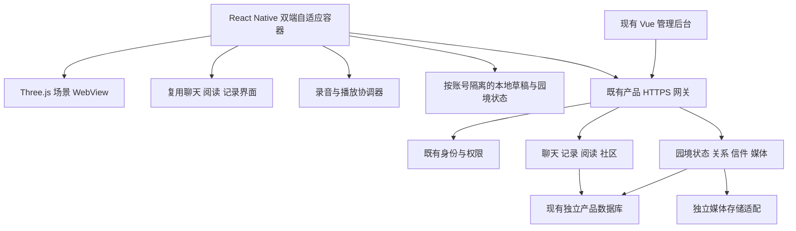

# Invelle iPad / iPhone 轻生活游戏 v1：前端、服务端与管理后台设计

> 2026-10-22 导航修订：首次进入全园俯视图，再进入所选空间全景，最后显式进入第一视角。返回逐级退出。以下旧路径中的 N00 起点应在此三级导航之后理解；导航状态须同时保留 nodeId 与 level。以[导航层级修订](Invelle轻生活游戏-v1-导航层级修订-20261022.md)为准。

日期：2026-10-21。状态：设计交付；未修改业务代码，未执行迁移，未部署。另有独立浏览器交互样板，不构成正式业务集成。产品范围、模型地址和 J01–J12 路径见[产品与空间设计](iPad轻生活游戏-v1-产品与空间设计-20261021.md)。

本稿中的新增目录、表、字段与接口均为设计候选；没有对应源码的条目不属于现有能力。默认在现有三个工程内实施，不新建游戏后端、不替换账号、不更换渲染引擎。

实施细化见[需求说明书](Invelle轻生活游戏-v1-需求说明书-20261021.md)、[第一视角操作规范](Invelle轻生活游戏-v1-第一视角操作规范-20261021.md)、[数据与接口对应](Invelle轻生活游戏-v1-数据与接口对应-20261021.md)、[本机存储与同步](Invelle轻生活游戏-v1-本地存储与同步机制-20261021.md)。四份说明细化当前设计；新增依赖及接口仍为设计，未安装或实现。

## 1. 已核实的工程基础和缺口

| 能力 | 当前源码依据 | 本版处理 |
| --- | --- | --- |
| 账号与身份 | `zenflow-mobile/src/core/zenflow/session.ts`；服务端 `identity/` | 复用 APP_USER、认证代次、退出和账号隔离 |
| 四个入口 | `zenflow-mobile/src/app/index.tsx` 的 rest/chat/create/notes | 双端共用园境容器与快捷导航，保留休息／聊天／创作／记录入口 |
| 三维容器 | `features/zenflow/garden.tsx`、`garden-files.ts`、`scripts/zenflow/garden-scene.js` | 复用 React Native + WebView + Three.js 路线；新增全园分区资源适配 |
| 现有休息页 | `features/zenflow/rest-space.tsx` 的 home/garden/pond/room/books | 接入统一地点状态和返回上下文，不能只堆独立页面 |
| 聊天 | `CoreApi`、`ZenflowConversationController`、`ZenflowRunController` | 复用会话、流式回应、取消、引用、获准上下文 |
| 私人记录 | `CoreApi.saveNote/saveExcerpt`、`ZenflowNoteController` | 复用正文、版本、置顶、删除与授权；新增附件及读书锚点 |
| 阅读 | `book-shelf.tsx`、`ZenflowBookReaderController` | 复用章节、版本、语言、书签、进度；私人批注需补 |
| 社区 | `CommunityApi`、`ZenflowCommunity`、`Community.vue`、`P06_community.sql` | 当前只含主帖、图片、审核、撤回；扩展愿签、回应、后续 |
| 语音输入 | `InvelleSpeechModule.swift`、`speech.ts`、`voice-input.tsx` | 当前通过设备语音识别输出文本，无录音文件保存契约 |
| 原生音频库 | `package.json` 已有 `expo-audio ~57.0.4`，本地类型包含录制／播放 API | 优先复用，不因为参考新文档顺手升级依赖 |
| 文件底层 | `matrix-common-file` 的 `FileTemplate`；`SysFileServiceImpl` | 可复用存储适配能力，产品媒体门面自行校验 APP_USER 与用途；不得暴露企业文件旁路 |
| 现有助手上传 | `AssistantAttachmentUploadService` | 仅有图片／文档类型，不支持原声；不把社交语音伪装成聊天附件 |
| 双端配置 | `app.json` 为 `orientation: portrait`、`supportsTablet: false` | 新增平板设备族及双端响应式布局、方向和设备构建验证 |
| 权限说明 | 麦克风说明当前包含「不保存录音」 | 引入原声后必须修改中英文说明及相关插件重复配置；未改前不可发布录音能力 |
| 启动能力 | `ZenflowProfileController.bootstrap()` 中 creation/notes 与聊天 ready 共用 | 拆分能力标记，AI 不可用时仍应允许园景、笔记和已开通社交 |

本轮仅做文件读取与 GLB 结构解析，没有请求生产账号、私人记录、模型供应商或数据库。因此以上是源码证据，不代表线上所有路径均已验收。

## 2. 整体结构与边界



### 2.1 客户端负责什么

- 场景加载、相机、热点、鱼群行为、涟漪、环境动画和临时布置预览。
- 原生文字输入、键盘避让、读书界面、麦克风、试听、手写、权限与无障碍。
- 明确展示本机草稿、已保存、同步中、待审核、已公开和发送失败等不同状态。
- 环境和视觉反馈不依赖每次 API 请求；内容发布、朋友关系、云端保存以服务端结果为准。

### 2.2 服务端负责什么

- 当前身份、内容可见性、父子资源授权、媒体归属、版本和幂等。
- 园境存档、帖子／回应／后续、朋友关系、来信与站内信盒。
- 公开内容审核、举报、撤回、删除传播；AI 沿既有陪伴服务，不进入公开互动代发流程。
- 分离 `sceneAvailable`、`notesAvailable`、`communityAvailable`、`voiceMediaAvailable`、`chatAvailable`。依赖缺失只关闭相应功能，不能假装成功或回退至其他租户配置。

### 2.3 管理后台负责什么

仅管理主动提交的公开内容、明确提交的举报证据、资源目录和必要服务状态。普通运营不能查看私人记事本、私人原声、AI 会话或整个朋友信箱。三维 `.blend` 编辑仍在 Blender 进行，管理后台不建设在线建模器。

## 3. 三维资产接入与版本设计

### 3.1 共享资源与用户状态分离

`sceneVersion` 指向共享静态资源和交互清单。`gardenId` 属于一个 APP_USER，保存 `stateVersion`、鱼实例、摆放状态与本人环境偏好。游戏不需要每个用户一份 GLB，也不需要持久在线房间或逐帧位置同步。

建议资源包拆为：公共地形／远景、廊下与鱼塘、许愿树平台、书房、抄写厅、个人小屋、对话小屋、后坡观景。共享纹理使用统一依赖清单，按视域加载近处细节，避免每包重复大纹理。`common` 常驻，其余包按最近使用淘汰；拍照只捕获已加载园景。

当前 145.27 MiB GLB 先作为母资产，必须制作小型样板验证纹理、透明水面、实例、动画和相机。压缩、合批、低细节模型与烘焙光照按实际剖析选择，不能仅压缩传输文件而忽略解码后的内存。导出工具、解码器和资产校验均跟随锁定版本，不额外安装一套引擎。

### 3.2 运行清单

正式清单建议字段：`schemaVersion`、`sceneVersion`、`minClientVersion`、`packages[{id,url,sha256,bytes,dependencies}]`、`zones`、`viewpoints`、`bindings`、`archetypes`、`placementAreas`、`environmentPresets`、`fallbackNodeId`。正式 URL 在资源发布后填写，本设计不编造已经上线的 CDN 地址。

产品锚点保持稳定，例如 `wish.take`、`wish.slot.1`、`notebook.open`、`pond.feed`。现有模型含小数和自动后缀的对象名只在版本映射表中出现，不进入用户存档或业务 API。

Blender 坐标为 +X 东、+Y 北、+Z 上；GLB 导出后坐标按其节点变换解释。运行时读取加载后的相机世界矩阵和朝向，不直接把 Blender JSON 三元组当作 Three.js 世界坐标，也不重复做一次轴变换。取相机后根据 iPad／iPhone 实际画幅重算可视范围并校验近裁面、热点位置。[Three.js GLTFLoader](https://threejs.org/docs/pages/GLTFLoader.html)

本设计绑定表只验证模型里存在相应相机／节点，未证明热点大小、可点击性、遮挡和坐姿舒适度。对新增锚点明确列缺件，禁止随便绑定临时纸或鱼身网格凑通过。

### 3.3 升级、缓存与回退

- 资源先下载临时目录，逐项校验后原子切换清单；保留上一个已验证版本。主文件变化不能在半次会话中偷偷改变相机与业务绑定。
- 用户存档保存逻辑锚点与鱼型 ID，模型升级通过映射迁移。未知摆件保留原数据并放入收纳，不静默删除；未知地点回廊下并保留原位置记录。
- 资源版本和业务状态版本分别校验。回退场景不回退用户笔记、朋友关系或已发送内容。
- WebView 退出释放纹理、几何、动画、事件和音频；`ImageBitmap` 等资源须按加载器要求释放，不能仅移除 DOM。
- 当前第三方资产的许可沿模型 `manifest/LICENSES.md` 和来源记录核验，重新打包发布时保留需要的许可说明。

### 3.4 天气与时段资源接入

复用模型现有的 `day`、`dusk`、`night`、`rain` 参数，以及渲染脚本的 `dawn`、`sunset` 观景状态。关灯 `off`／`lamp_off` 在适配层统一为 `lampEnabled=false`；减少动态按设备设置处理。详细版本与文件哈希见[天气资产核查](ipad-v1-evidence/weather-source-review.json)。p3-v039 GLB 场景 extras 有 `weather_states`，但未发现天气动画片段；不能把参数存在当作运行时天气已实现。

`environmentPresets` 每项建议包含 `id`、`revision`、光照／天空映射、材质覆盖、雨效配置、音频资源引用及设备降级策略。建立经过验证的节点／材质绑定；不在客户端直接执行 Blender 脚本，也不把 Cycles 曝光、世界节点或程序化天空数值原样当作 Three.js 效果。天气状态清单的版本字段不一致，正式导出必须针对选定 sceneVersion 重新核验；当前 p3-v042 不替换本稿固定 p3-v039 的相机绑定。

使用同一份几何和共享纹理，分别保存原始灯光与材质基线，以便雨天退出、连续预设切换和取消预览时完整恢复。室内／屋檐遮雨范围需沿区域清单补充；不通过每人复制一份 GLB 或每种天气复制整园实现。动态降雨、雨声及授权音源、室内衰减、移动端阴影与夜间可读性均是待补项，不宣称模型包已包含可直接运行的完整天气系统。

切换按「校验预设与资源 → 本机预览 → 确认保存 → garden/state 同步」执行；加载失败回退至进入设置前的有效环境，保留本人原选择。旧客户端不识别的预设暂以 `day` 显示，不能自动覆盖服务端未知值。资源升级／回退必须覆盖默认值和环境字段兼容。状态中只存选择，粒子位置、湿润过渡进度、实时光照和设备音量不上传。

环境音复用 AudioCoordinator，遵循静音、录音独占与来信播放优先；不得因天气切换恢复已关闭的声音。减少动态停止降雨粒子与闪动，保留静态光照和湿润材质；低画质减少粒子、阴影和反射，不改变用户所选预设或功能权限。首版不接定位、真实天气 API、自动昼夜调度或天气与私人情绪关联。

## 4. iPad／iPhone 前端与账号设计

### 4.1 推荐模块分工

在 `zenflow-mobile/src/features/zenflow/` 下新增 `garden-shell/` 子目录，复用现有功能组件，不复制整套聊天／阅读逻辑。以下文件名为建议：

| 模块 | 职责 |
| --- | --- |
| `GardenShell` | 场景容器、地点列表、四类快捷入口、弹层、账号变化与返回栈 |
| `SceneHost` / `SceneBridge` | WebView 生命周期、严格消息协议、资源版本、相机与热点反馈 |
| `NavigationState` | `nodeId`、模式、进入来源、返回位置、当前内容和临时草稿引用 |
| `WishTreePanel` | 有限批次的新签／我的签／朋友近况、详情、回应、后续、举报及回园中入口 |
| `WishComposer` | 文字／图片／原声组合、范围确认、提交快照 |
| `FriendsPanel` / `MailboxPanel` | 关系请求、朋友来信、未读、屏蔽 |
| `PondInteraction` / `PlacementEditor` | 本地互动、鱼名与鱼型、有限摆放、保存与冲突 |
| `VoiceMessageComposer` / `VoicePlayer` | 原声录制与试听；与现有聊天语音输入区分 |
| `AudioCoordinator` | 全局唯一人声播放、录制独占、雨声等环境声降低、中断恢复 |
| `EnvironmentController` | 天气／时段预设、灯光、切换取消与保存、设备效果降级；不管理社交权限 |
| `NotebookPanel` / `DrawingPage` | 接入现有记录；新增原声与可编辑笔迹附件 |

数据访问在 `src/core/zenflow/` 内新增小型 `garden.ts`、`social.ts`、`media.ts`，继续调用 `ZenflowSession.request`。不从场景脚本读取 SecureStore、持久化令牌或直连供应商。

### 4.2 交互状态与桥接协议

```text
LOADING → IDLE_LOOK → TRANSITION → IDLE_LOOK
IDLE_LOOK → OBJECT_INTERACTION → IDLE_LOOK
IDLE_LOOK → CONTENT_PANEL → EDITING / RECORDING / PLAYBACK → CONTENT_PANEL
任意状态 → SUSPENDED → 校验身份与资源 → 可恢复状态
```

同一时刻只有一个交互模式；键盘、手写、录音和摆放态不响应镜头拖动。系统返回优先退出当前操作，不直接清空整座园境。录音被打断时进入可试听草稿，不自动发送；临时纸不采用普通草稿恢复规则。

桥接消息建议包含 `protocolVersion`、`requestId`、`sceneInstanceId`、`identityGeneration`、`type` 和限定 `payload`。允许事件如 `scene.ready`、`hotspot.activate`、`navigation.arrived`、`placement.preview`、`scene.failed`；原生可发送 `settings.apply`、`navigate.to`、`scene.suspend`、`garden.snapshot`。

所有消息按白名单验证类型、长度、逻辑锚点和当前会话；旧实例与旧身份代次的回调直接丢弃。WebView 只请求功能意图，保存、发信、投稿必须经原生交互确认和服务端鉴权。WebView 不拥有用户 ID、管理员权限或媒体访问令牌，不接受任意 URL 或任意脚本桥接。

内容面板按入口明确呈现「仅自己保存」「投稿到许愿树」「寄给指定朋友」。投稿成功先进入 PENDING，批准后才执行公共挂签反馈；拒绝、撤回和目标失效时更新显示与音频。愿签列表只在主动点击「再看一些」后请求下一批，保留当前位置；返回原视点不自动提交草稿。没有新消息时显示真实空态，不生成占位真人留言；无点赞、粉丝、热度、亲密度、在线和催回复提示。

### 4.3 屏幕与输入

当前先完成 iPad 横屏视觉与原生模拟器路径，再进行 iPhone 适配；共用契约和状态从第一步就按双端设计。用户暂无实体 iPad，开发检查与最终设备验收分开，不因缺真机停掉不依赖真机的工作。

- 同一 App、同一场景状态与功能组件；用可用窗口宽度选择宽／窄布局，用独立设备性能档选择画质。不能沿用当前仅 `Platform.OS === 'web'` 的桌面判断，也不能让分屏 iPad 强制显示宽侧栏。
- iPad 横屏为主，宽窗口采用场景加侧栏；iPhone 竖屏优先，阅读、聊天、愿签与信箱采用全屏原生页。双端支持方向变化，保留 `nodeId`、返回栈、正文滚动位置和本人草稿；旋转不重建会话或重复发请求。
- 第一视角共用逻辑地点，按画幅重算视野并检查近裁面；需要手机专用构图时在同一 `viewpointId` 下配置变体，不复制路线与用户状态。热点使用足够大的命中区域，并提供原生地点／物件列表。
- 书籍正文、字幕、录音试听和笔记支持字号、键盘避让、VoiceOver；iPad 补左右手和外接键盘布局。手机底部只留少量可达操作，展开地点表后避免与系统手势冲突。
- 镜头环顾、拨水、拖摆件和手写保持模式互斥。减少动态时立即到达；静音仍可操作。手机支持指触手写与缩放，不依赖 Apple Pencil。
- 休息／聊天／创作／记录保留为双端快捷功能入口，进入园境也可从地点触发相同组件。账号、社交、语音及个人园境不因手机低画质被裁减。
- 正式构建核验生成后的 iOS 设备族、横竖屏支持、安全区及权限文案；不能只改 `app.json` 就称已支持。最低 iPhone／iPad 由样板实测确定，当前不承诺具体型号。

### 4.4 原声与手写

原声优先调用当前已安装 `expo-audio`，录制与现有 `InvelleSpeech` 争用麦克风时由 `AudioCoordinator` 串行处理。首版可先录原声、停止后按需生成文字稿；不为了边录边转写开启两套互相竞争的 Audio Session。[Expo SDK 57 音频文档](https://docs.expo.dev/versions/v57.0.0/sdk/audio/)

录音在本机封装后加密为本人草稿，达到长度／容量上限停止录制；重录、取消清理被丢弃录音，退出账号清理会话临时文件并锁定已落盘的未发草稿，重新验证原账号后才能恢复。申请麦克风前说明用途，禁止自动开启后台录音。拒绝权限可继续文字输入，耳机断开和系统音频中断均停止播放，恢复后需用户主动继续。

已保存私人原声与待发送录音分开管理；送入云端转写前明确用途，不默认复用私人原声训练、长期分析或公共知识。公开投稿时可为审核生成服务端转写，但审核对象仍为提交的原声加文字稿。

手写首版需保存可编辑源和预览图。建议用小型原生绘图桥接承接 PencilKit，复用现有 Expo 本地模块组织方式；不要通过三维材质每帧回传笔迹。无 Apple Pencil 时提供指触书写与键盘记录。PencilKit 的具体绑定、文件格式和版本兼容需先做小样，尚未实现。[Apple PencilKit](https://developer.apple.com/documentation/pencilkit)

### 4.5 离线、同步和冲突

园境偏好与布置可以离线改动；首次下载未完成的区域明确标记不可用，不伪造完整世界。账号下的未发送语音、笔记和手写草稿本地保护保存，重连只上传已经确认的操作，不自动公开未确认草稿。

园境以聚合 `stateVersion` 做乐观锁；服务端返回冲突时保留本机版本，允许重新加载或明确覆盖指定变更，不使用全量最后写入覆盖其他设备。笔记沿现有记录版本机制。发帖／发信在线确认后在本地记录 `clientRequestId` 和提交快照，结果未知时查询回执或同键重试，禁止生成第二条内容。离线点击仅保留草稿，联网后需再次确认；冷启动／重新登录后未派发的社交操作也需再确认，已派发未知结果先对账。

退出／切换账号：停止所有录音播放，销毁 WebView 私人状态和在途请求，清除该次会话草稿可见性；持久本地记录按所有者保护，不进入下一账号。重新登录同一账号后才允许恢复待处理内容。

本机存储建议采用 SDK 57 兼容的 expo-sqlite／SQLCipher 处理草稿与队列事务，复用现有 SecureStore、FileSystem 和 Crypto；详见[本机机制](Invelle轻生活游戏-v1-本地存储与同步机制-20261021.md)。当前没有安装或实现。首版无网冷启动只进入公共游客园景，私人库保持锁定；同进程已验证身份后断网可以继续编辑本人已解锁内容。浏览器样板不替代原生加密验证。

### 4.6 Apple、邮箱与统一账号

账号原则沿用[海外首版登录设计](../海外首版登录设计-20261006.md)及[账号与数据边界](../账号与数据边界-v0.3.md)。本次在园境入口优先展示 Apple 与邮箱；Google／Facebook 现有代码及老用户登录路径保留，不因入口调整失效。以下将源码已具备与待实现项分开。

| 能力 | 本轮源码核对 | 本版接入或缺口 |
| --- | --- | --- |
| 邮箱验证、注册、重设密码 | `ZenflowAuthController`、`ZenflowAccountService`、`EmailChallengeService` 已有；`session.signIn()` 使用系统认证会话 | 复用现有页面和认证中心，补回到园境原操作的上下文；本轮未发送邮件、未做真实登录 |
| Apple 登录 | `external-login.ts` 使用 `expo-apple-authentication`，返回 identity token；服务端 `ExternalIdentityVerifier` 校验签名、issuer、audience、有效期、nonce | 复用此链路，不能把源码存在当作正式应用配置和真机验收通过 |
| 第三方绑定／解绑 | `session.bind/unbind`、`ExternalLoginController`、`ExternalAccountService` 已有 | 沿已有近期认证校验，身份冲突不合并；保留至少一种可用登录方式 |
| Apple 账号增加邮箱密码 | 当前邮箱服务只见注册／重设，不能把注册接口当绑定接口 | 需在原 APP_USER 上新增验证邮箱并设置密码的原子操作，不新建用户 |
| Apple 上游授权生命周期与账号删除 | 现有 Apple 客户端只返回 identity token，未形成授权码交换／撤销与销号完整链路 | 补授权码服务端处理、撤销与通知、删除作业及可重试状态；正式发布前闭环验收 |

登录完成只使用服务端认定的 `tenant + APP_USER + userId` 读取园境，不信任场景、客户端上报 owner 或提供方邮箱。Apple 外部身份按 provider、应用作用域和稳定 subject 解析；隐藏邮箱和首次姓名缺失不影响身份稳定性。公开昵称单独设置，不从 Apple 姓名或邮箱推导。

既有接口继续复用：`POST /zenflow/v1/auth/external/challenge`、`/auth/external/complete`、`GET /account/login-methods`、`DELETE /account/login-methods/{provider}`；后续三个路径同属 `/zenflow/v1`。邮箱沿 `/auth/email/challenges`、`/auth/email/verifications`、`/auth/registrations`、`/auth/password-resets` 及系统 OAuth 授权码／PKCE 流程。当前邮箱接口受浏览器会话及 CSRF 边界保护，不从场景 WebView 直接调用，也不为适配游戏绕开保护。

待新增的邮箱绑定使用独立 `BIND_EMAIL` 验证用途，绑定票据包含目标用户、身份代次和有效期；要求近期重新认证、验证码一次使用、邮箱唯一约束和事务提交。注册／重设票据不可用于绑定。具体 API 在实现时扩展现有 `identity` 模块，禁止借找回密码给 Apple 账号隐式添加密码。未来修改邮箱或解绑同样先验证原账号，并检查剩余可用方式。

客户端仅在原生层持有令牌：access token 留内存、refresh token 用既有 SecureStore。认证代次在登录／退出／切换时递增，迟到回调必须丢弃。`pendingIntent` 只保留允许的地点、内容 ID 和受保护草稿引用，不包含密码或 token；登录成功重新校验内容权限，恢复编辑页后仍需确认才能发布、发信或保存。登录取消回原地点；会话过期不清空允许恢复的草稿，也不把它归到下一账号。

Apple 配置检查包括实际应用标识、签名能力、客户端开关和服务端 audience；缺配置明确显示不可用，并保留邮箱入口，发布验收仍要求 Apple 可用。密钥和授权码处理仅在服务端，不放入 GLB、场景脚本或日志。邮箱验收覆盖真实送达、重复邮箱、验证码过期／限频、错误密码、重设后的旧会话失效，不改现有密码规则或另造认证中心。

退出只终止会话并隔离本地数据。账号删除要求近期认证及明确确认，立即阻断新访问，按已有数据原则清理园境、私人笔记、媒体和关系；公开内容撤回及必要举报证据按明确保留规则处理。作业失败可重试，Apple 授权撤销单独留状态，不能只删除本机 token 后显示账号已删除。管理后台只呈现必要的账号状态、登录方式标记和作业状态，不展示密码、完整 token、Apple 隐藏邮箱或私人正文。

### 4.7 双端同步与游客导入

- 鱼与摆件使用同一 `gardenId/stateVersion`；已确认保存的私人记录、手写和原声按原授权同步。阅读进度遵守原有同步开关；本机临时纸、未发送语音和草稿不自动同步。
- 镜头、横竖屏、画质和音量为设备偏好；账号园境保存逻辑地点作为可选恢复提示，各设备不互相强制切镜头。
- 游客试玩存于独立匿名本地空间。首次登录后先查云端园境：存在则加载；不存在且用户同意导入时，发送带幂等键的首次创建，服务端原子检查不存在。并发另一设备已创建时返回冲突并加载云端，不覆盖。游客私人正文和媒体不在该导入载荷内。
- 两端离线编辑重连时带基础版本，冲突保留双方版本并提供明确选择。身份变化立即取消旧请求、媒体访问和恢复任务；只在再次验证原账号后恢复其待同步内容。

## 5. 服务端领域与最小数据扩展

业务仍放在 `zenflow/zenflow-biz/`。新增 `garden`、`social`、`media` 小模块；社区、笔记与阅读继续在原领域扩展，不另造通用内容平台。

### 5.1 建议数据结构

| 对象／拟定表 | 字段与约束要点 | 处理方式 |
| --- | --- | --- |
| `zf_garden_state` | tenant、APP_USER owner、sceneVersion、stateVersion、fish/placements JSON、environment JSON、updatedAt；每人唯一 | 新增；首版鱼量少，暂不拆鱼／家具明细表 |
| `zf_profile` 社交字段 | 公开昵称、预置 avatarKey、socialVersion；沿用 public_id | 扩展现有档案；公开名不得回退到邮箱或真实姓名 |
| `zf_community_post` | 新增 entryKind、rootPostId、replyToId、language、anonymous、repliesOpen；沿用已有 state/version | 扩展原表，主帖／愿签／回应／后续共用审核，不再建一套帖子表 |
| `zf_social_relation` | tenant、有序 userA/userB、requester、state、version；用户对唯一 | 新增；PENDING/ACCEPTED/DECLINED/CANCELLED/REMOVED |
| `zf_social_block` | tenant、blocker、blocked、createdAt；方向对唯一 | 新增；双向访问时检查任一方屏蔽，不借匿名绕过 |
| `zf_social_letter` | sender、recipient、正文、version、deliveryState、senderHidden、recipientHidden、withdrawnAt | 新增；私信式来信只给已接受朋友 |
| `zf_social_inbox` | recipient、eventType、targetType/Id、eventKey、readAt、createdAt；事件去重 | 新增；站内提醒不复制完整私人正文 |
| `zf_media_asset` | tenant、owner、purpose、storageKey、mime、bytes、duration、sha256、processingState、version、expiresAt | 新增媒体登记；底层存储复用 FileTemplate 适配能力 |
| `zf_media_binding` | mediaId、targetType/Id、targetVersion、role；绑定与内容同事务 | 新增；目的和父对象权限一致，不能把私有附件 ID 直接升为公共 |
| `zf_content_report` | reporter、targetType/Id/version、reason、evidenceRef、state、reviewer | 新增；公开报告或用户明确提交的私人来信快照 |
| 既有 note 元数据 | bookId、releaseId、chapterId、paragraph/quoteHash、drawingFormat 等 | 附加到版本化记录元数据或一对一关联，复用原 capsule 主体 |

表名为设计名称；正式迁移前核对现有 schema、服务方法和运行环境。所有业务 ID 使用既有 ID 策略，均由服务端生成或验证，不接受客户端伪造所有者。每个读取按受信 tenant、subjectType、subjectId 校验。

园境 `environment` 建议为 `{presetId, lampEnabled}`，随 `stateVersion` 同步，字段按服务端允许值校验并受同一所有者隔离。游客仅保存本机；登录用户的并发冲突、离线队列和跨账号清理复用园境机制。客户端仅修改鱼或摆件时不覆盖环境字段，旧客户端缺字段时保留服务端原值；未来自动时间模式不预建调度表。

### 5.2 社交公开档案

现有 `/profile` 含 `email`、`accountEmail`，displayName 还可能回退到邮箱前缀。因此新增公开 DTO 只返回 `publicId`、用户主动设置的公开昵称、预置头像及允许公开的关系状态。未设置昵称时使用中性的系统别名，不暴露认证资料。首次公开发帖或加朋友时确认公开名片。

匿名内容不返回作者 publicId、个人主页链接或可推导身份的媒体路径；后台依旧保留可信所有者，用于撤回、屏蔽和举报。匿名不承诺消除原声中自述或声音带来的可识别性。

### 5.3 社区兼容与状态机

`entryKind` 建议值：`POST`、`WISH`、`REPLY`、`FOLLOWUP`。旧 `category` 的 ESSAY/SHORT/POEM 继续服务原创作客户端；愿签用新 kind 区分，不能把旧诗文全部改成愿望。

旧客户端未传 kind 的列表继续只返回 `POST`，新增园境 feed 明确请求需要的 kind。旧接口创建默认 `POST`，不能让老客户端误渲染缺字段的语音愿签和子回应。

```text
本机草稿 → 确认投稿 → PENDING → APPROVED / REJECTED
PENDING 或 APPROVED → 作者撤回 WITHDRAWN
APPROVED → 管理下架 REMOVED
```

回应和后续独立审核，但可见性依赖根愿签。根签撤回／下架后，所有子条目和媒体对外即时不可见，即使子条目仍保留原审核记录。新增后续只允许根签作者；回应允许当前可访问根签且未被屏蔽的登录用户。通知只在内容成为可见状态后投递。

### 5.4 朋友与来信

朋友请求由服务端验证公开身份、屏蔽和现有关系；对同一用户对的并发请求合并，不生成两份关系。拒绝、取消和移除使用版本条件，重复请求受频率限制。

来信发送事务同时验证关系 ACCEPTED、双方账号有效、未屏蔽、媒体可用且属于发送者；写入信件与通知 outbox，成功后才显示已寄出。正文和原声不放进通知负载。

移除朋友默认阻止新来信，历史来信保留双方已收取的副本；任一方屏蔽后双方不再经该关系获得内容访问，界面可隐藏历史条目。发送者可撤回以停止后续服务端访问，但不承诺删除对方已经听见、截图或导出的内容。接收者可单方删除自己的信箱条目。具体默认语义在实施评审时确认。

私人来信不进入日常公共审核列表。收件人举报时明确提交所选信件和必要上下文，审核人员只见该证据包；不得因此获得任意用户信箱查询能力。

### 5.5 私人世界隔离：服务端执行要求

用户已确认每人一个独立世界，通过许愿树交流。隔离依据是受信会话解析的 `tenant_id + APP_USER + owner_user_id`，不能只靠前端切数组、不同 localStorage key 或隐藏页面。公共模型文件可以共用，私人存档不能共用。

- 园境 API 统一使用清单中的 `GET/PATCH /garden/state` 表达当前用户的园境，不另增 `/garden/me` 别名。查询、创建、更新、删除都在数据访问层带完整所有者条件；请求里的 owner/userId 不能覆盖会话主体。管理员主体不能伪装为 APP_USER，普通运营无权浏览私人园境。
- 创建园境采用每所有者唯一约束，更新同时校验 owner 与 stateVersion。按 ID 查询鱼、摆件、私人媒体和笔记时同样复验归属；知道另一个 gardenId 或 mediaId 不等于有读取权限。无权对象统一返回不可见，不暴露是否存在。
- 公开愿签单独存为审核内容快照，只复制明确选择的正文和经用途授权的媒体绑定。公共 DTO 不返回 gardenId、owner 的私人字段、笔记引用、聊天上下文或私人文件地址；公共列表不通过关联查询顺带返回作者园境。
- 对象存储前缀区分租户、所有者和用途，但前缀不是鉴权。媒体下载先校验当前业务绑定与可见性，使用受限授权访问；账号切换后禁止复用旧授权 URL、解码音频和私人缓存。撤回即时阻断新访问，已缓存内容按客户端失效协议处理。
- 私人缓存 key、离线队列、上传草稿与后台任务必须携带租户、主体、所有者和授权代次。退出／换号销毁当前私人 WebView 状态、取消请求和播放；旧回调、过期任务即使随后又登录原账号也须重新校验，不能直接执行。
- 朋友关系只赋予来信权限，不赋予彼此世界或笔记的读写权。公共树的可见性还要检查审核、撤回、屏蔽与父子内容状态；双方不能通过好友接口绕过这些规则。
- 备份、日志、搜索索引和统计遵守相同边界；不把私人状态送进公共搜索、运营试聊或公共知识。删除账号时覆盖本人园境及私人媒体，并按既定规则处理公开内容及必要举报证据。

实施验收必须用两名真实测试账号和一个管理员主体，直接构造越权请求验证服务端拒绝；本机演示身份切换通过，只说明样板交互分离，不代表上述要求已经实现。

## 6. 媒体处理、权限与删除

### 6.1 录音上传流程

```text
本机录制与试听
  → 用户确认保存／投稿／寄送
  → 建立上传记录与用途
  → 以二进制上传（限长、限流、校验）
  → 校验 MIME／容器／时长／大小并登记
  → READY 或处理失败
  → 与目标笔记／帖子／来信版本绑定
  → 按父对象状态获取播放流
```

复用底层 FileTemplate，不复用企业文件 HTTP 接口的认证边界。本轮未核实产品音频存储配置，正式接入前必须验证独立 bucket／前缀、凭据与备份。配置缺失时关闭录音上传；不得借用衍智云账号或回退到公开目录。

首版建议经产品网关流式上传、鉴权后播放，避免长效公共 URL。播放支持范围请求以实现拖动进度，每次请求重新验证父对象和用户权限；撤回后停止新请求。已在设备缓冲的内容无法远程抹除，客户端收到撤回后停止播放并清缓存。

`purpose` 固定为 PUBLIC_SUBMISSION、PRIVATE_NOTE 或 FRIEND_LETTER，不允许客户端原地改用途。私人内容主动公开时生成独立提交快照和独立授权的媒体记录；内容相同不代表权限可共用。不可仅凭 mediaId 或上传者身份获得已经绑定到他人资源的音频。

### 6.2 权限矩阵

| 内容 | 本人 | 其他用户／朋友 | 普通运营 |
| --- | --- | --- | --- |
| 私人笔记／原声／笔迹 | 按本人权限读写 | 不可见 | 不可见 |
| 私人愿签 | 按私人记录管理 | 不可见 | 不可见 |
| 待审公开投稿／回应 | 作者可见 | 不可见 | 只见本次主动提交快照 |
| 已批准公开内容 | 作者及符合访问条件者 | 登录且未受屏蔽限制时可见 | 可审核、下架 |
| 朋友来信 | 发送者／接收者按状态访问 | 仅指定对方，不能转授给其他朋友 | 默认不可见 |
| 来信举报证据 | 举报者可看处理状态 | 不向无关用户开放 | 仅有工单权限的审核者见所选证据 |
| 园境鱼与布置 | 本人读写 | 首版没有整园访问权 | 仅必要版本／失败元数据，无私人正文 |
| 社交公开名片 | 本人维护 | 公开 DTO | 按用户管理职责处理 |

公开内容审核需听取原声或可靠的音频审核服务并提供人工复核；仅有 ASR 不等于音频审核通过。ASR 服务失败时保持待审，不把失败转为 APPROVED。转写模型与既有陪伴模型分别配置，不为获得转写能力修改用户聊天模型。

### 6.3 清理与重试

- 未绑定上传过期清理、用户取消草稿清理、内容撤回后的访问撤销、笔记／账号删除后的媒体物理清理分别处理。
- 延续现有 outbox／删除 worker 模式；同事务记录撤回或删除事件，异步删除失败可重试。先阻断访问，再清理对象与派生文字、波形、预览和缓存。
- 举报证据与被举报内容使用单独受限保留策略，不能被普通播放接口访问；保留期限与删除规则须在开放语音社交前确认并配置，不无限保存。
- 日志只记 ID、状态、字节数、时长、错误类别和延迟，不记录音频、转写正文、私人笔迹或访问令牌。

## 7. 接口设计清单

### 7.1 直接复用的主要路径

基础路径为 `/zenflow/v1`。以下已在本地源码核实，但本次没有在线调用：

| 路径 | 现有用途 |
| --- | --- |
| `GET /bootstrap`、`GET /profile`、既有 auth 路径 | 能力、本人资料、认证 |
| `/conversations`、`/conversations/{id}/messages`、`/runs/{id}/events` | 会话、发问、流式结果；沿原方法与契约 |
| `/notes`、`/notes/{id}/state`、`/notes/{id}/versions`、`/notes/{id}/consents` | 记录、版本、状态、授权 |
| `GET /books`、`GET /books/{id}/versions/{version}` | 书目与按语言／章节读取 |
| `GET/POST/DELETE /books/state` | 本人阅读进度和书签同步 |
| `GET/POST /community/posts`、`POST /community/posts/{id}/withdraw` | 主帖与撤回 |
| `POST/GET/DELETE /community/attachments...` | 现有公开投稿图片；不作为私人原声接口 |
| `POST /voice/corrections` | 识别后的文字修正，不能接收原声替代上传 |

### 7.2 新增或扩展的候选契约

所有下表路径为拟定设计，尚不可调用。路径仍位于 `/zenflow/v1`；正式实施同步修改 Controller、端点白名单、安全配置与网关。

| 方法与路径 | 输入要点 | 输出／权限规则 |
| --- | --- | --- |
| `GET /scene-manifests/{version}` | 资源版本 | 非私人资源清单、hash、兼容范围 |
| `GET /garden/state` | 当前身份 | 本人园境、stateVersion；不存在不隐式创建 |
| `PATCH /garden/state` | expectedVersion、clientRequestId、有限操作数组；首次用 expectedVersion=0 的 INIT | 服务端验证鱼型／锚点／数量／摆放范围和环境预设白名单；仅本人，返回新版本 |
| `GET/PATCH /social/profile` | 修改用 expectedVersion、公开昵称、avatarKey | 本人社交设置；修改内容按公开名片规则处理 |
| `GET /social/profiles/{publicId}` | 公开 ID | 严格公开 DTO，无邮箱／私人状态 |
| `GET /community/tree` | cursor、language、view、limit；上限由服务端限制 | items、nextCursor、hasMore；仅已批准且有权查看内容，不返回热度／点赞／粉丝计数 |
| `POST /community/posts` 扩展 | entryKind、text、mediaIds、anonymous、clientRequestId | POST/WISH；沿审核；有原声时允许正文为空 |
| `GET/POST /community/posts/{id}/entries` | cursor；entryKind=REPLY/FOLLOWUP、replyToId、text、mediaIds | 根签权限、后续作者限制；创建进入 PENDING |
| `PATCH /community/posts/{id}/reply-policy` | expectedVersion、repliesOpen | 仅根签作者 |
| `GET/POST /social/friend-requests` | targetPublicId、clientRequestId | 请求列表／发起请求 |
| `POST /social/friend-requests/{id}/decision` | expectedVersion、ACCEPT/DECLINE/CANCEL | 按请求角色允许动作 |
| `GET /social/friends`、`DELETE /social/friends/{publicId}` | 删除用 expectedVersion | 本人关系；不公开朋友列表 |
| `POST/DELETE /social/blocks/{publicId}` | 幂等操作 | 屏蔽／解除；不自动恢复朋友关系 |
| `GET/POST /social/letters` | 分页；recipientPublicId、text、mediaIds、clientRequestId | 双方关系、归属和资源校验 |
| `GET /social/letters/{id}` | 内容 ID | 仅指定双方，且未撤回／无屏蔽 |
| `POST /social/letters/{id}/withdraw` | expectedVersion | 发送者撤回；新媒体访问立即失效 |
| `DELETE /social/letters/{id}` | expectedVersion | 删除本人收／发件箱条目，不冒充双方物理删除 |
| `GET /social/inbox`、`POST /social/inbox/{id}/read` | cursor／expectedVersion | 仅本人；不可见目标不返回敏感摘要 |
| `POST /media/uploads` | purpose、mime、bytes、duration、sha256 | uploadId、服务器限制、短期有效期 |
| `PUT /media/uploads/{id}/content` | 二进制内容、校验信息 | 限流流式接收，不用 Base64 整段占用内存 |
| `POST /media/uploads/{id}/complete` | expectedVersion | 受理校验处理，不等于可公开或已发送 |
| `GET /media/{id}/status`、`GET /media/{id}/content` | 媒体 ID；播放可带 Range | 状态／鉴权流；按父对象重验 |
| `DELETE /media/{id}` | expectedVersion | 本人未绑定草稿可删；已绑定走父内容生命周期 |
| `GET /operations/{clientRequestId}` | operationType、当前身份 | 新增操作回执；业务写入同事务，超时先对账，详见配套契约 |
| `POST /community/reports` | targetType/Id/version、reason、selectedContextIds | 明确所提交证据，返回报告 ID |

愿签根列表按批准发布时间与稳定 ID 排序，游标绑定排序位置、语言与视图；每页重新检查根签状态、屏蔽和权限，朋友近况仅筛选允许公开内容。撤回导致当前页为空时仍如实返回，不用未审核内容补足；不建立热门权重或按情绪强度推荐。客户端仅主动翻批，服务端限制单批大小并处理重复 ID。分批是展示策略，不能代替分页鉴权。

私人笔记的媒体关联扩展现有保存契约，输入 `mediaIds` 与可选 `sourceAnchor`，保持旧的纯文字请求有效。字段必须在服务端建立白名单，不能将任意扩展 JSON 送入 AI。

统一写入规则：所有创建／发送具有 `Idempotency-Key` 或等价 clientRequestId；同一身份同键同内容返回原结果，同键异内容报冲突。状态变更传 expectedVersion；ID、父资源、权限、媒体归属和目标状态在事务内复核。

标准错误语义：401 需登录或会话失效；403 无权限或关系不允许；404 不存在或不可见；409 版本／幂等内容冲突；413 超限；422 格式或状态不满足；429 频率限制；503 依赖不可用。错误正文不得泄露被屏蔽者身份、私人内容或内部存储地址。

通知采用事务 outbox，按 `eventKey + recipient` 去重。前台进入树／信盒时刷新，并进行低频可见态更新；只更新真实事件提示，不因此替换正在阅读的批次或自动滚屏；不新增全园多人 WebSocket。聊天既有 SSE 保持不变。后续通知推送需另行授权与设备许可。

## 8. 管理后台开发设计

在现有 Vue / Element Plus / Pinia 工程和 `src/api/zenflow/client.ts` 上扩展。新增菜单与原角色权限一起控制，不从消费者页面复用管理员 token。

| 页面 | 复用／新增 | 必须能完成的工作 | 不展示 |
| --- | --- | --- | --- |
| 社区审核 | 扩展 `Community.vue` | 筛选主帖／愿签／回应／后续；显示根签上下文、文字、图片、音频试听、转写、提交版本；批准／驳回／下架 | 未投稿草稿、关联私人笔记正文 |
| 举报处理 | 新增 `CommunityReports.vue` | 查看被举报内容的授权证据；下架、限制或驳回报告；记录原因和操作人 | 任意用户完整信箱／聊天历史 |
| 社交名片 | 扩展用户管理中的受限区 | 公开昵称／头像审核或重置、社交状态与必要限制 | 邮箱作为公开昵称、私人关系详情无边界浏览 |
| 场景资源 | 新增轻量只读清单页 | 当前 sceneVersion、包 hash、大小、兼容客户端、缺件和回退版本 | 在线编辑 Blender、上传任意脚本 |
| 游戏内容配置 | 轻量配置页 | 已审核鱼型、摆件、预置贴纸、语言和功能开关 | 针对私人情绪的个性化任务、付费经济体系 |
| 媒体处理状态 | 扩展服务状态 | 失败数、大小／时长、处理状态、清理重试 | 私人音频播放入口、转写正文日志 |
| 书籍／陪伴配置 | 沿用现有页面 | 现有版本发布、内容与模型维护 | 将社交愿签自动纳入公共知识或试聊 |

审核按钮校验当前版本与状态，过期页面不可覆盖新状态；播放待审音频的权限仅对该提交有效。公开发布与下架均留操作记录。声称审核通过必须包括真正被展示的原声、文字稿与图片组合，不能只勾选转写文字。

## 9. 性能与设备验证建议

以下是首轮工程目标，必须在选定最低设备后测量，不能作为已经通过的性能承诺：

- 基础场景目标稳定 30 FPS；较新设备可选择更高质量／帧率。先测 20 分钟持续使用后的帧时间与发热，再定最低支持设备。
- 已缓存的首次交互目标 5 秒内；区域切换目标 2 秒内。慢网或首次下载给真实进度和可用区域，不伪造加载成功。
- 内存、纹理大小和 draw calls 由样板测量后设预算；主导风险是大模型、透明水面与高分辨率纹理，不以 GLB 文件体积替代显存数据。
- 后台停止渲染、录音和非必要音频；在阅读／输入界面降低场景帧率或静止，减少无意义耗电。
- 最少覆盖一台拟定最低配置的非 Pro iPad、一台较新 iPad、一台拟定最低配置 iPhone 和一台较新 iPhone，以及不同尺寸／方向／窄窗口；具体型号与系统版本在设备可用时登记。

## 10. 实施批次、验收与回退

| 批次 | 工作内容 | 通过条件 |
| --- | --- | --- |
| D0 最小场景验证 | 锁定模型，制作廊下／鱼塘／许愿树分区包，优先 iPad 横屏桥接、相机和恢复 | 浏览器与 iPad 模拟器有运行证据后可继续开发；实体设备性能与触感独立保留 NOT_VERIFIED，不能据此宣称首版验收 |
| D1 基础能力 | 双端壳、Apple／邮箱登录与账号闭环、公开名片、能力分离、媒体上传／播放／撤回、必要审核页 | 双端真实登录、身份／用途隔离、原声试听、失败恢复、权限文案与真实包一致 |
| D2 社交主流程 | 愿签、回应、后续、关系、来信、信盒、举报 | 两账号完成 J01–J04，覆盖关闭回应、拉黑、撤回、重试去重 |
| D3 私人生活 | 鱼与布置、天气／时段环境存档、阅读笔记、手写、原声记事、聊天、呼吸 | J05–J11 可完成和返回；A33–A36 验证环境切换与恢复，私人数据不进入公共审核 |
| D4 整体验证 | 中英双语、双端同步、旧手机客户端、网络与账号切换、资源回退、设备舒适度 | 下表关键情境全部有证据；未过项如实列 PARTIAL/BLOCKED/FAIL |

迁移采用新分期脚本，编号在实施时检查最新最大序号再定；不得修改已执行的 P06，也不执行早期设计 DDL。先做兼容性迁移与备份演练，再分别开放服务端能力和客户端入口。具体部署沿项目既有授权与 checklist，本次不执行。

回退优先关闭新增 capability 与切回兼容资源版本，不删除新增用户数据，不回滚旧用户笔记。旧版 App 不应收到新 kind 的内容或不兼容字段。迁移、对象存储备份和数据库恢复需保持绑定一致性。

### 10.1 关键验收矩阵

| 编号 | 情境 | 预期 |
| --- | --- | --- |
| A01 | 两账号各有自己的鱼与摆件 | 相同模型，不同状态，无串号 |
| A02 | 拖动水面／笔迹／摆件 | 只执行当前模式，不同时转镜头 |
| A03 | 发布原声愿签并由另一账号回应 | 原声可听，待审不泄露，批准后才出现通知 |
| A04 | 根签撤回时子回应、音频正在加载 | 新访问拒绝，客户端停止相关播放与显示 |
| A05 | 匿名作者被屏蔽 | 不因匿名恢复展示，响应不暴露身份 |
| A06 | 来信发送时朋友被移除／屏蔽 | 事务复验阻止发送，不产生假成功通知 |
| A07 | 上传成功但发信超时，重复点击 | 同一幂等键只有一封信，可查询原回执 |
| A08 | 管理员尝试查询私人录音／笔记 | 拒绝访问；仅可看明确提交的举报证据 |
| A09 | 麦克风拒绝、电话中断、耳机断开 | 可改文字，保留允许的草稿，绝不自动发送 |
| A10 | 断网编辑、另一设备改名或摆放 | 冲突可见，保留本机改动，不静默覆盖 |
| A11 | 保存手写后退出重开 | 可继续编辑笔迹，非只有预览图 |
| A12 | 从阅读摘句到笔记再带去聊天 | 来源版本可追溯，只用主动选入内容 |
| A13 | 退出账号后旧下载／SSE／播放回调返回 | 丢弃旧结果，不写入新账号 |
| A14 | AI 配置不可用 | 园景、笔记和已开通社交仍可用，聊天如实关闭 |
| A15 | 新模型缺锚点或升级中断 | 保留旧资源，回安全视点，不删除用户状态 |
| A16 | 模拟旧版手机客户端请求 | 原帖子分类和阅读／聊天不回归 |
| A17 | 20 分钟鱼塘、录音播放和场景切换 | 有帧率、内存和发热证据，无持续资源增长 |
| A18 | 开启减少动态、静音、VoiceOver | 核心路径可完成，文字可读，听不到声音也可操作 |
| A19 | 删除笔记或账号 | 原声、笔迹、转写、派生预览与绑定按规则清理，失败可重试 |
| A20 | iPhone 竖屏、横屏、iPad 分屏中打开内容并旋转 | 地点、滚动位置和草稿保留，键盘不挡提交，核心路径均可达 |
| A21 | Apple 首次、重复、隐藏邮箱、取消授权 | 身份稳定，取消不创建账号，不依赖姓名，实际配置的真机通过 |
| A22 | 邮箱注册、登录、忘记密码与邮件失败 | 可恢复、无假成功；验证码用途隔离，重设后旧会话失效 |
| A23 | 邮箱账号绑定 Apple；Apple 账号绑定邮箱；邮箱相同但账号不同 | 绑定后仍为原用户，冲突不合并，无身份验证不能添加登录方式 |
| A24 | 同一账号在 iPad 保存鱼／布置，在 iPhone 打开 | 状态一致；并发冲突可见；未发送语音不自动跨端上传 |
| A25 | 游客导入时另一设备已有存档，或切换账号 | 不覆盖已有园境，不导入私人正文，不串号 |
| A26 | Apple 撤销、账号删除、删除作业重试 | 会话失效，私人资源不可再访问，服务端和上游处理均有真实结果 |
| A27 | B 直接请求或修改 A 的 gardenId、鱼、笔记和媒体 ID | 服务端按受信主体拒绝；即使有 ID 或好友关系也不放行 |
| A28 | 普通管理员访问私人园境；缓存和离线队列跨账号回放 | 拒绝读取／写入；旧身份缓存、任务和签名访问不能泄露给新身份 |
| A29 | 树下浏览完当前批次、没有新消息、返回园中 | 不自动续载、不伪造消息；主动翻批才加载，可自然退出且保留本人草稿 |
| A30 | 私人保存、公开投稿、驳回、批准后挂签 | 范围与状态可辨认；待审仅作者可见，公共动画和通知不早于批准 |
| A31 | 未加朋友、请求被拒、接受、移除后尝试来信与读取园境 | 只有当前双方同意时可发信；朋友也无法访问私人园境、笔记；无催回复与社交计分 |
| A32 | 下一批加载时根签撤回、作者被屏蔽或权限变化 | 服务端复验，不返回失效内容；真实空态，重复 ID 去重，不擅自刷新当前阅读位置 |
| A33 | 六种环境预设预览、取消、保存、切换及旧版未知值 | 取消恢复原环境；切换不重建园境／丢草稿；未知值临时回退，不覆盖原存档 |
| A34 | A／B 选择不同环境，同账号双端并发保存，离线后切账号 | 各自独立，同账号冲突可见；旧账号队列不写入新账号；音量不跨设备强制同步 |
| A35 | 雨天进屋、听来信、录音、静音与减少动态 | 无穿透屋檐雨丝；声音优先级正确；静音不被切换覆盖，减少动态无持续粒子 |
| A36 | 夜间导航与阅读，雨天切回白天，连续切换后后台恢复 | 路径、热点与正文可辨认；材质恢复，无音频重叠或持续内存增长；目标双端记录实际性能 |

补充验收：[操作规范](Invelle轻生活游戏-v1-第一视角操作规范-20261021.md)的 I01–I10，以及[本机机制](Invelle轻生活游戏-v1-本地存储与同步机制-20261021.md)的 L01–L16，与 A01–A36 一起由 G17 汇总。需求映射见 FR01–FR20。

### 10.2 本次交付状态

本次仅核对源码、模型清单、公开技术资料并撰写文档。执行文档链接、绑定引用、JSON 和 Git 可见性检查，不运行与文档无关的应用构建或业务测试。最终结果记录在 [validation.json](ipad-v1-evidence/validation.json)。iPad／iPhone 性能、Apple／邮箱真实登录、真实录音、业务联调与发布均未由本次工作证明。

## 11. 实施前少量待确认项

1. 最低支持的 iPad／iPhone 和目标年龄范围：影响性能预算、录音交互与社交治理设计。
2. 审核方式与可承诺时效：默认公开音频和文字均先审后见；人工工作量不能被「已有社区后台」掩盖。
3. 语音时长／容量、举报证据保留期限：本文给出工程候选值，不视为最终运营承诺。
4. 公开昵称、匿名签与关系历史的最终文案：首版按本文保守默认设计，实施前以小样确认。

其余技术细节可在既有工程内按本设计推进评审；本稿不构成开发、生产迁移、上架或付费采购授权。
